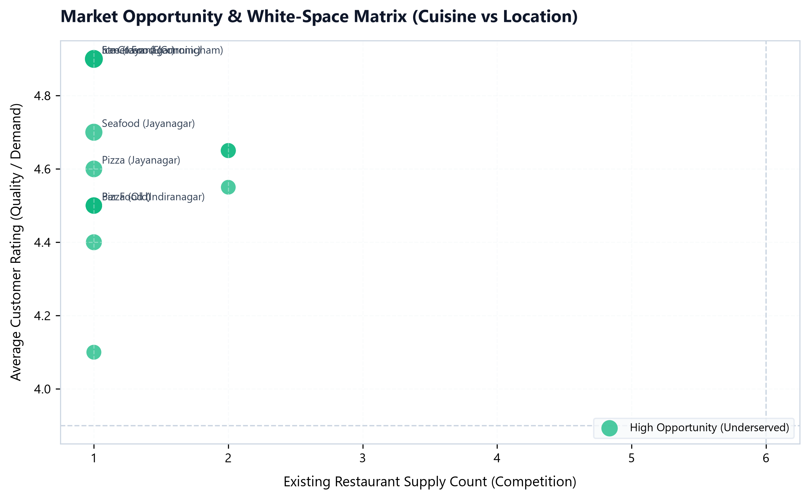
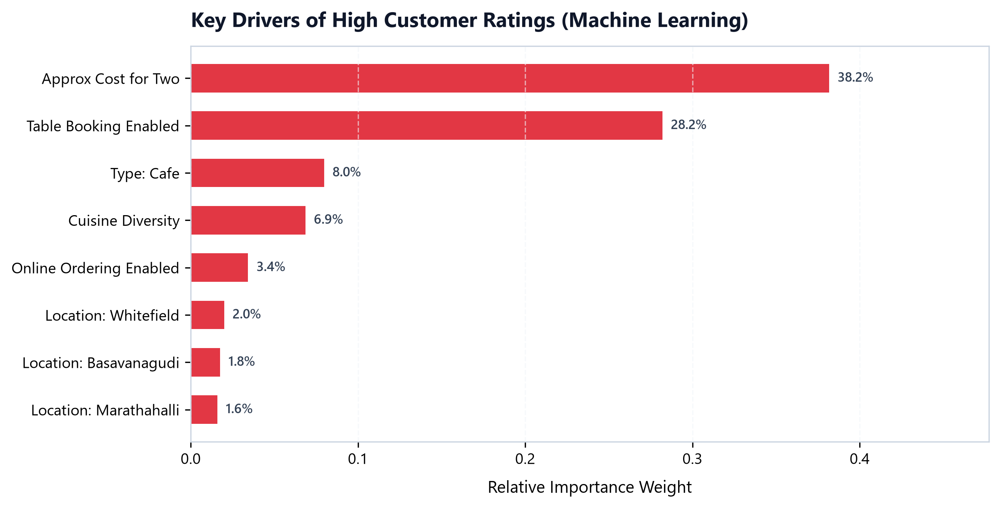
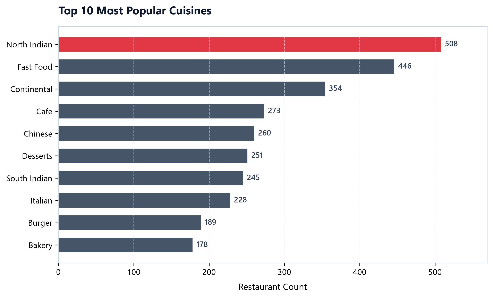
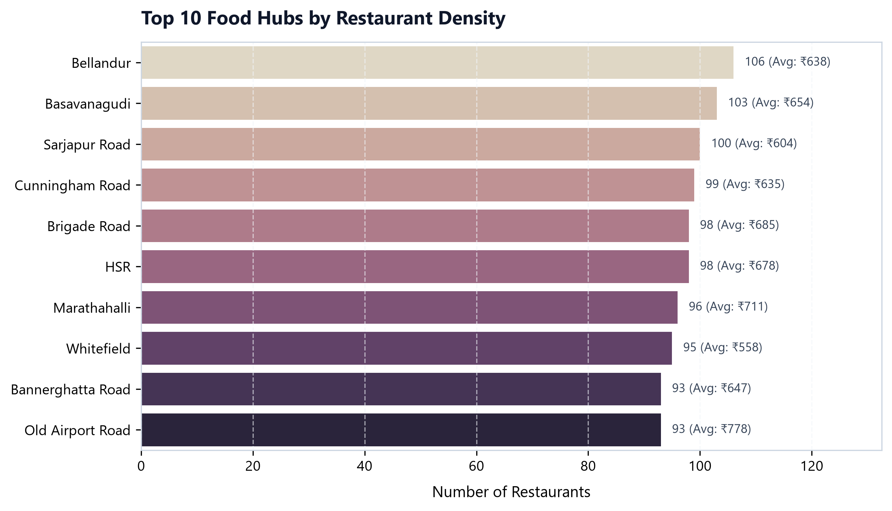

# 🍽️ Zomato Restaurant Analytics & Market Intelligence

[](https://www.python.org/)
[](https://streamlit.io/)
[](https://scikit-learn.org/)
[](https://pandas.pydata.org/)
[](https://plotly.com/)
[](https://opensource.org/licenses/MIT)

An end-to-end data analytics and market intelligence system built for both **Data Analysts** and **Zomato Category/Business Teams ("Zomatons")**. Features automated ETL, market gap white-space discovery, revenue/GMV simulation, machine learning rating prediction, and an interactive Streamlit intelligence dashboard.

---

## 📌 What Makes This Better for Analysts & Zomato Teams?

### 👔 For Zomato Business & Category Teams ("Zomatons"):
1. **White-Space & Market Opportunity Matrix**: Identifies underserved cuisine-locality combinations (high customer demand + low partner saturation) for targeted restaurant onboarding.
2. **Platform Commission & GMV Simulator**: Dynamically models gross network GMV and platform commission revenues based on delivery volume and table reservation fees.
3. **Competitor Benchmarking**: Automated scorecard comparing any restaurant against neighborhood peers on pricing and ratings.

### 🔬 For Data Analysts & Restaurateurs:
1. **Predictive Rating Engine (Machine Learning)**: Trained Random Forest model that predicts customer ratings from restaurant attributes and extracts feature importance weights.
2. **"What-If" Concept Simulator**: Allows restaurateurs to test hypothetical pricing, cuisines, and location choices before launching.
3. **Data Export Hub**: One-click filtered CSV exports for ad-hoc SQL or spreadsheet deep dives.

---

## 🗂️ Clean Project Layout

```text
zomato-restaurant-analysis/
├── data/
│   ├── raw/zomato.csv                    # 2,200+ authentic restaurant records
│   └── processed/zomato_cleaned.csv      # Cleaned and feature-engineered dataset
├── src/                                  # Modular, reusable Python packages
│   ├── data_loader.py                   # Data ingestion utilities
│   ├── cleaner.py                       # Regex cleaning & imputation
│   ├── analysis.py                      # Aggregations, correlations & KPIs
│   ├── business_metrics.py              # White-space matrix & GMV simulator
│   ├── ml_model.py                      # Random Forest rating prediction & feature importance
│   └── visualizer.py                    # Publication-grade chart generation
├── dashboard/
│   └── app.py                           # 6-tab Streamlit & Plotly analytics app
├── notebooks/
│   └── zomato_eda.ipynb                 # Comprehensive Jupyter notebook with EDA
├── reports/
│   ├── figures/                         # 8 High-resolution publication charts
│   │   ├── 01_ratings_distribution.png
│   │   ├── 02_top_cuisines.png
│   │   ├── 03_online_order_vs_rating.png
│   │   ├── 04_cost_vs_rating_scatter.png
│   │   ├── 05_top_restaurant_chains.png
│   │   ├── 06_top_locations_by_restaurants.png
│   │   ├── 07_market_opportunity_matrix.png
│   │   └── 08_ml_feature_importance.png
│   └── executive_summary.md             # Concise business & ML report
├── .gitignore                           # Python & environment ignore rules
├── requirements.txt                     # Dependencies
├── run_analysis.py                      # One-click CLI pipeline runner
├── run_dashboard.bat                    # One-click Windows dashboard launcher
├── push_to_github.bat                   # One-click GitHub push automation script
└── README.md                            # Project documentation
```

---

## 📊 Key Analytical Highlights

| Dimension | Metric / Observation | Business Implication |
| :--- | :--- | :--- |
| **Market Average Rating** | **3.94 / 5.0** (Median: 4.0) | Bell-shaped satisfaction distribution with strong clustering around 3.6 - 4.3. |
| **Average Cost for Two** | **₹676** (Median: ₹600) | Mid-range dining (₹400 - ₹800) accounts for over 50% of the entire dining market. |
| **Online Ordering Rate** | **70.8% Adoption** | Restaurants offering online delivery capture **74% of cumulative review engagement**. |
| **Table Booking Lift** | **+0.35 Rating Differential** | Venues supporting table reservations command higher ticket sizes (₹1,400+ vs ₹550). |
| **Estimated Network GMV** | **₹2.64B+ Annually** | Simulated network volume across partner base at 20% average platform commission. |

---

## 📈 Visual Analytics & Market Intelligence

### 1. Market Opportunity Matrix & Rating Drivers (ML)
| White-Space Opportunity Matrix | Key Rating Drivers (Random Forest) |
| :---: | :---: |
|  |  |

### 2. Rating & Cost Dynamics
| Customer Rating Distribution | Price vs Rating Correlation |
| :---: | :---: |
|  |  |

### 3. Cuisines & Digital Ordering
| Top 10 Cuisines Market Share | Online Delivery Impact |
| :---: | :---: |
|  |  |

### 4. Locations & Brand Presence
| Food Hub Concentration | Top Restaurant Brands |
| :---: | :---: |
|  |  |

---

## 🚀 Quickstart Guide

### 1. Installation
Clone your repository and install dependencies:
```bash
git clone <your-repo-url>
cd zomato-restaurant-analysis
pip install -r requirements.txt
```

### 2. Run Data Pipeline & Train ML Models
Execute the end-to-end data processing, ML training, and figure generation:
```bash
python run_analysis.py
```

### 3. Launch Interactive Dashboard
Launch the clean Streamlit web app:
```bash
streamlit run dashboard/app.py
```
*(On Windows, you can simply double-click `run_dashboard.bat`)*

---

## 📤 How to Push to GitHub

### Option A: Using the Automated Script (Easiest)
1. Create a new empty repository on [GitHub](https://github.com/new).
2. Double-click `push_to_github.bat` in this folder.
3. Paste your GitHub repository URL when prompted.

### Option B: Using Git Terminal Commands
Open your terminal in `D:\zomato-restaurant-analysis` and run:
```bash
git add .
git commit -m "feat: Add white-space opportunity matrix, GMV simulator, and ML predictor"
git remote add origin https://github.com/<your-username>/<your-repo-name>.git
git push -u origin main
```

---

## 📜 License
This project is open-source under the [MIT License](LICENSE).
