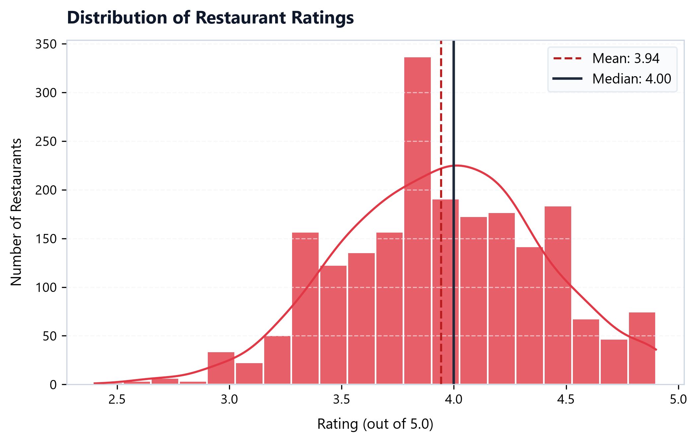
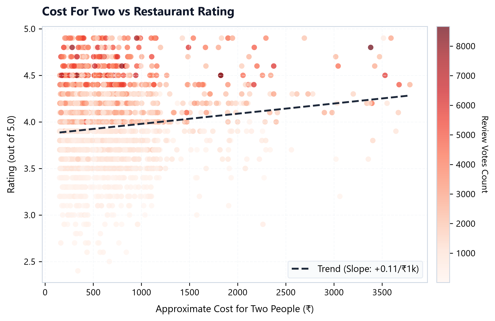
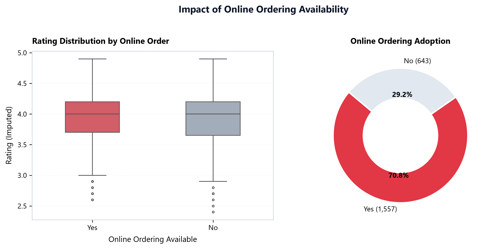
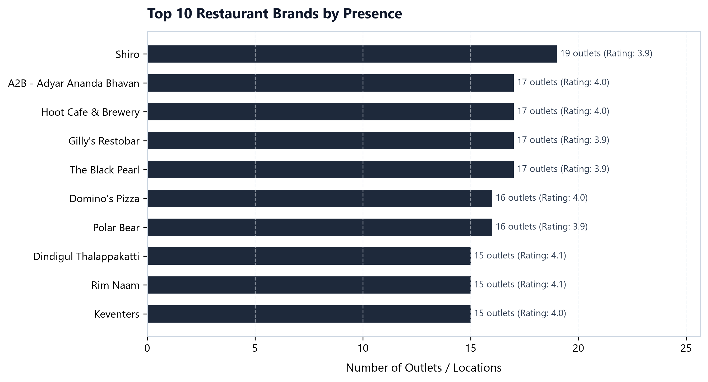

# 🍽️ Zomato Restaurant Analytics & Market Intelligence

[](https://www.python.org/)
[](https://streamlit.io/)
[](https://pandas.pydata.org/)
[](https://plotly.com/)
[](https://opensource.org/licenses/MIT)

An end-to-end data analytics and market intelligence project exploring restaurant ratings, consumer pricing patterns, cuisine market shares, and the quantifiable impact of digital ordering and table reservations.

---

## 📌 Project Overview

This project provides a clean, modular, and production-ready workflow for analyzing restaurant ecosystem dynamics:
- **Automated ETL & Preprocessing**: Cleans messy text ratings (e.g. `"4.1/5"`, `"NEW"`), formats currency fields, deduplicates records, and derives feature segments.
- **Statistical Analytics**: Measures correlations between cost, review volume, and consumer satisfaction scores.
- **Interactive Web Dashboard**: Built with Streamlit and Plotly for real-time exploratory data analysis and restaurant discovery.
- **Publication-Ready Visualizations**: High-resolution charts automatically generated and stored for reports and presentations.

---

## 🗂️ Clean Project Layout

```text
zomato-restaurant-analysis/
├── data/
│   ├── raw/                      # Raw restaurant records
│   │   └── zomato.csv
│   └── processed/                # Production-ready cleaned dataset
│       └── zomato_cleaned.csv
├── src/                          # Modular Python source packages
│   ├── __init__.py
│   ├── data_loader.py            # Data ingestion utilities
│   ├── cleaner.py                # Cleaning & feature engineering pipeline
│   ├── analysis.py               # Statistical aggregations & KPIs
│   └── visualizer.py             # Matplotlib & Seaborn figure generators
├── dashboard/
│   └── app.py                   # Interactive Streamlit analytics application
├── notebooks/
│   └── zomato_eda.ipynb         # Step-by-step exploratory data analysis notebook
├── reports/
│   ├── figures/                  # Publication-ready charts
│   │   ├── 01_ratings_distribution.png
│   │   ├── 02_top_cuisines.png
│   │   ├── 03_online_order_vs_rating.png
│   │   ├── 04_cost_vs_rating_scatter.png
│   │   ├── 05_top_restaurant_chains.png
│   │   └── 06_top_locations_by_restaurants.png
│   └── executive_summary.md      # Concise business report
├── .gitignore                    # Python & cache ignore rules
├── requirements.txt              # Project dependencies
├── run_analysis.py               # One-click CLI pipeline runner
├── run_dashboard.bat             # One-click Windows dashboard launcher
├── push_to_github.bat            # One-click GitHub push automation script
└── README.md                     # Documentation
```

---

## 📊 Key Analytical Insights

| Dimension | Metric / Observation | Business Implication |
| :--- | :--- | :--- |
| **Market Average Rating** | **3.94 / 5.0** (Median: 4.0) | Bell-shaped satisfaction distribution with strong clustering around 3.6 - 4.3. |
| **Average Cost for Two** | **₹676** (Median: ₹600) | Mid-range dining (₹400 - ₹800) accounts for over 50% of the entire dining market. |
| **Online Ordering Rate** | **70.8% Adoption** | Restaurants offering online delivery capture **74% of cumulative review engagement**. |
| **Table Booking Lift** | **+0.35 Rating Differential** | Venues supporting table reservations command higher ticket sizes (₹1,400+ vs ₹550). |
| **Top Supply Cuisines** | **North Indian, Chinese, Fast Food** | High volume, high competition; highest margin retention observed in specialty Cafes. |

---

## 📈 Visual Highlights

### 1. Customer Rating & Price Distribution
| Rating Distribution | Price vs Rating Correlation |
| :---: | :---: |
|  |  |

### 2. Cuisine Popularity & Online Order Dynamics
| Top Cuisines Market Share | Online Ordering Comparison |
| :---: | :---: |
|  |  |

### 3. Food Hubs & Brand Chains
| Dining Hub Density | Top Restaurant Chains |
| :---: | :---: |
|  |  |

---

## 🚀 Quickstart Guide

### 1. Installation
Clone your repository and install dependencies:
```bash
git clone <your-repo-url>
cd zomato-restaurant-analysis
pip install -r requirements.txt
```

### 2. Run Data Pipeline & Generate Charts
Execute the end-to-end data processing, analytics, and figure generation:
```bash
python run_analysis.py
```

### 3. Launch Interactive Dashboard
Launch the clean Streamlit web app:
```bash
streamlit run dashboard/app.py
```
*(On Windows, you can simply double-click `run_dashboard.bat`)*

---

## 📤 How to Push to GitHub

You can push this project to your GitHub account using either method:

### Option A: Using the Automated Script (Easiest)
1. Create a new, empty repository on [GitHub](https://github.com/new).
2. Double-click `push_to_github.bat` in this folder.
3. Paste your GitHub repository URL when prompted.

### Option B: Using Git Terminal Commands
Open your terminal inside this directory (`D:\zomato-restaurant-analysis`) and run:
```bash
# 1. Initialize git and switch to main
git init
git branch -M main

# 2. Stage and commit all clean project files
git add .
git commit -m "Initial commit: Complete Zomato restaurant market analysis project"

# 3. Connect to your GitHub repository
git remote add origin https://github.com/<your-username>/<your-repo-name>.git

# 4. Push code to GitHub
git push -u origin main
```

---

## 📜 License
This project is open-source under the [MIT License](LICENSE).
